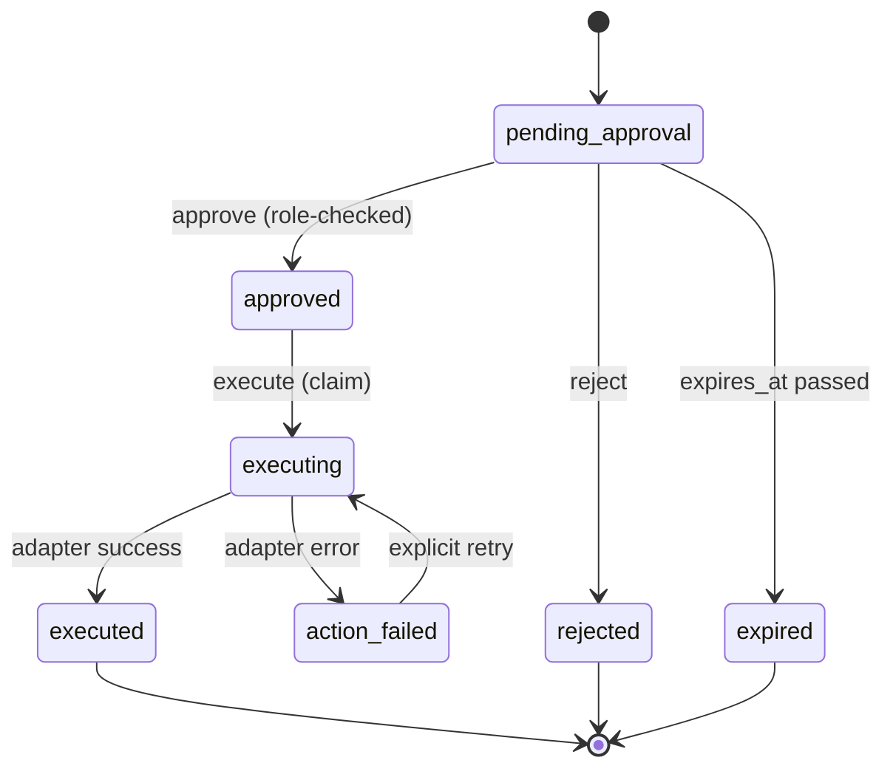

# Architecture

## Shape

Autopilot is a single Python 3.12 process with four boundaries: webhook intake,
model generation, proposal approval, and forge writes. Only the last one can
change something outside the process, and it is reachable only through an
approved proposal.

```mermaid
flowchart LR
    GH[GitHub] -->|signed webhook| API[api.py<br/>verify + dedupe]
    API --> NORM[webhooks.py<br/>normalize]
    NORM --> STORE[(SQLite<br/>store.py)]
    NORM --> WF[workflows.py]
    WF --> DUP[duplicates.py<br/>deterministic candidates]
    WF --> GW[gateway.py<br/>budget + cache + ledger]
    GW --> PROV[providers.py<br/>fake | OpenAI-compatible]
    WF --> SCHEMA[schemas.py<br/>closed output schema]
    SCHEMA --> STORE
    CLI[cli.py] --> WF
    API --> WF
    STORE -->|approved proposal| EXEC[workflows.execute<br/>claim once]
    EXEC --> ADAPT[adapters.py<br/>local fixture | GitHub]
    ADAPT -->|comment, labels| GH
    STORE --> AUDIT[(hash-chained<br/>audit_events)]
```

## Module responsibilities

| Module | Responsibility |
| --- | --- |
| `config.py` | Environment settings, validation, fail-closed checks |
| `db.py` | SQLite schema, migrations, foreign keys, append-only triggers |
| `store.py` | Persistence and every state transition that gates side effects |
| `models.py` | Normalized domain types; nothing downstream parses raw webhook JSON |
| `canonical.py` | Canonical JSON, hashing, constant-time comparison |
| `redaction.py` | Secret and personal-data redaction before persistence or logging |
| `webhooks.py` | Size check, HMAC verification, event/action allowlist, normalization |
| `duplicates.py` | Token overlap and title similarity; no model involvement |
| `prompts.py` | Versioned templates, untrusted-content framing, injection signals |
| `providers.py` | Provider protocol, deterministic fake, OpenAI-compatible client |
| `schemas.py` | Hand-written validation of model output; rejects unknown fields |
| `gateway.py` | Pre-call budget enforcement, response cache, model-call ledger |
| `workflows.py` | Generation, proposal creation, approval, gated execution |
| `adapters.py` | Forge boundary: local fixture, GitHub, GitLab boundary |
| `runtime.py` | One place that assembles the object graph |
| `api.py` | Router, webhook intake, JSON API, static dashboard |
| `cli.py` | Operator commands over the same runtime |
| `logging_setup.py` | Log formatter that redacts before emission |

## Data flow for one issue

1. GitHub posts `issues.opened` with `X-Hub-Signature-256`.
2. `api._webhook` verifies size, signature, event, and delivery ID. A duplicate
   delivery ID returns `{"status": "duplicate"}` without reprocessing.
3. The payload is normalized into `Repository` and `Issue`; a verified delivery
   may create the repository row, but grants no role.
4. `WorkflowEngine.triage_issue` loads repository settings, checks that the
   workflow is enabled, computes deterministic duplicate candidates, builds a
   versioned prompt with redacted context, and asks the gateway for a completion.
5. The gateway checks the daily request limit and spend caps first, then records
   a ledger row for the attempt (success, failure, or cache hit).
6. The response is parsed and validated against the closed triage schema. Invalid
   output raises before any proposal exists.
7. A proposal row is written with the validated payload, the input hash, the
   prompt version, the model request ID, and an expiry. The action is a comment
   draft only; labels are suggestions in the payload, not applied.
8. `POST /api/proposals/{id}/approve` records the actor and timestamp.
9. `POST /api/proposals/{id}/execute` claims the proposal with a conditional
   `UPDATE ... WHERE state IN ('approved','action_failed')`, calls the adapter,
   stores the posted comment with an idempotency key, and appends `action.executed`.

## Proposal state machine



Every transition is a single SQL statement whose `WHERE` clause encodes the
precondition, so two concurrent approvals or a double-clicked execute cannot both
win. There is no automatic retry: a failure returns the proposal to
`action_failed` and the operator decides.

## Persistence

SQLite with `PRAGMA foreign_keys = ON` and WAL. Tables: `repositories`,
`repository_settings`, `actors`, `repository_actors`, `webhook_deliveries`,
`issues`, `pull_requests`, `comments`, `proposals`, `model_calls`,
`model_cache`, `audit_events`, `schema_migrations`.

`audit_events` has `BEFORE UPDATE` and `BEFORE DELETE` triggers that abort. Each
row stores `prev_hash` and `hash` over the canonical JSON of the row, so
`autopilot audit verify` recomputes the chain and reports the first broken row.
Deleting a repository's content removes issue, comment, and proposal rows,
anonymizes cost rows, deletes the repository row, and appends one
`repository.deleted` event with counts only.

## Cost control

`ModelGateway` is the only path to a provider. Before each call it computes the
budget state from `model_calls` since the start of the day and month, compares it
to the per-repository limits, and raises `BudgetExceeded` without calling the
provider. Responses are cached by prompt version, input hash, model, and
temperature. The ledger records tokens, latency, and estimated cost per call, so
`/api/metrics` and the CLI can attribute spend to a repository and workflow.

## Trust boundaries

| Boundary | Control |
| --- | --- |
| Internet → webhook route | HMAC signature, size cap, event allowlist, replay dedupe |
| Issue content → prompt | Framed as data inside `CONTEXT_JSON`; injection signals logged |
| Model → business logic | Closed schema, enum checks, cross-reference checks, no action field |
| HTTP client → API | Loopback trust, or admin token + actor header for remote |
| Actor → approval | Repository role (`owner`, `maintainer`, `approver`) checked in SQL |
| Process → forge | Only `approved`/`action_failed` proposals, claimed once |

## Deployment

One process, one SQLite file, one webhook secret. The receiver can run behind a
tunnel or reverse proxy; see `docs/self-hosting.md`. There is no queue, no
worker, and no external database in 0.1.
